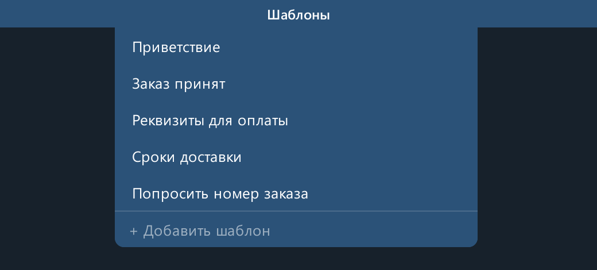
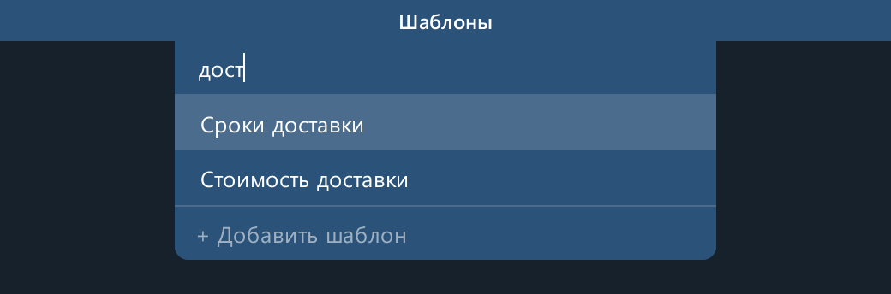

# Shtorka

[](https://github.com/team-kontora/shtorka/actions/workflows/ci.yml)
[](https://github.com/team-kontora/shtorka/releases/latest)


[](LICENSE)

Шаблоны сообщений для Telegram Desktop на Windows. На заголовке окна Telegram появляется вкладка «Шаблоны»: наведите на неё мышь, и выпадет список заготовленных ответов. Один клик вставляет текст в открытый чат.



Telegram при этом не меняется: Shtorka работает отдельным процессом и пристраивается к его окну снаружи.

## Возможности

- **Вставка в один клик.** Клик по названию вставляет текст в открытый чат, двойной клик копирует его в буфер обмена, правый клик открывает меню «вставить / скопировать / изменить / удалить».
- **С клавиатуры.** В Telegram нажмите `Ctrl+Space`: откроется шторка с поиском. Наберите часть названия или текста, переключайтесь между шаблонами клавишами `Tab` и `Shift+Tab` (или стрелками) и нажмите `Enter`, текст вставится в чат. `Esc` закрывает шторку и возвращает курсор в Telegram. Сочетание можно сменить в меню значка в трее: «Горячая клавиша…», затем нажать нужные клавиши.
- **Не мешает.** Вкладка видна, только пока Telegram открыт и активен. Она не перекрывает кнопки окна, а окно можно перетаскивать и разворачивать за неё, как за обычный заголовок.
- **Оформление.** Цвет и форма шторки выбираются в меню значка в трее. Оттенки подсветки и цвет текста подбираются под выбранный фон.
- **Общие шаблоны.** Все шаблоны хранятся в одном JSON-файле. Его можно передать коллеге или поправить вручную, программа подхватит изменения без перезапуска.
- **Установка без прав администратора и автообновление** из GitHub Releases.



## Установка

Скачайте `ShtorkaSetup.exe` со страницы [Releases](https://github.com/team-kontora/shtorka/releases/latest) и запустите. Программа ставится в `%LOCALAPPDATA%\Programs\Shtorka` для текущей учётной записи: права администратора и Python не нужны.

Установщик не подписан, поэтому SmartScreen может показать предупреждение: «Подробнее» → «Выполнить в любом случае».

После установки Shtorka сидит в трее. В меню значка можно включить «Запускать вместе с Windows». Удаляется программа через «Параметры → Приложения»; шаблоны и настройки в `%APPDATA%\shtorka` при этом остаются.

## Шаблоны и настройки

Шаблоны лежат в `%APPDATA%\shtorka\templates.json`:

```json
[
  { "title": "Приветствие", "text": "Здравствуйте! Чем могу помочь?" }
]
```

Если файл повреждён (например, опечатка при ручной правке), Shtorka не перезапишет его, а сообщит об ошибке.

Необязательный `%APPDATA%\shtorka\config.json` появляется сам, когда вы меняете оформление. Ручные правки в нём вступают в силу после перезапуска Shtorka.

```json
{ "process_names": ["telegram.exe", "ayugram.exe"], "color": "#2b5278", "style": "rounded", "auto_update": true, "hotkey": "Ctrl+Space" }
```

| Ключ | Значение |
|---|---|
| `process_names` | процессы, к окнам которых пристраивается шторка; сюда можно добавить неофициальный клиент Telegram |
| `color` | цвет шторки, `#rrggbb` |
| `style` | `flat` — прямоугольная, `rounded` — со скруглёнными нижними углами |
| `auto_update` | `false` отключает автообновление |
| `hotkey` | сочетание, которое открывает шторку с клавиатуры; удобнее задать его через трей. Формат: `Ctrl`, `Alt` или `Win` (можно вместе с `Shift`) и буква, цифра, `Space` или `` ` ``, например `"Alt+Q"` или `"Ctrl+Shift+F"`. Клавиши `F1`–`F24` можно и без модификаторов. `""` отключает сочетание. Сочетание перехватывается, только пока активен Telegram, у других программ оно не отнимается |

## Как это устроено

Python 3.11, PySide6 (Qt 6) для интерфейса и Win32 API через `ctypes` для всего, что касается чужого окна.

| Модуль | Что делает |
|---|---|
| [`tgwin.py`](shtorka/tgwin.py) | Находит главное окно Telegram по имени процесса, учитывает DPI, рабочую область монитора и «спрятанные» окна DWM. Передаёт перетаскивание и разворачивание окну Telegram и вставляет текст эмуляцией Ctrl+V. |
| [`drawer.py`](shtorka/drawer.py) | Сама шторка: прозрачное окно без рамки поверх заголовка Telegram. Раз в 100 мс сверяется с положением окна, прячется, пока его двигают или меняют размер, и анимирует выпадающий список. Левый край вкладки выравнивается по границе списка чатов: её положение находится по строке пикселей, снятой с экрана. |
| [`hotkey.py`](shtorka/hotkey.py) | Глобальное сочетание клавиш через `RegisterHotKey`. Сочетание из окна настройки записывается по коду физической клавиши, поэтому `Ctrl+Q` остаётся `Ctrl+Q` в любой раскладке, а занятое другой программой сочетание выбрать нельзя. Оно регистрируется, только пока активен Telegram, и снимается, когда тот уходит в фон. Сообщение `WM_HOTKEY` шторка ловит в `nativeEvent`, забирает фокус у Telegram, а после вставки или `Esc` возвращает его обратно. |
| [`store.py`](shtorka/store.py) | Хранилище шаблонов и поиск по ним: все слова запроса в любом регистре, «ё» и «е» не различаются, совпадения в названии идут первыми. Следит за изменениями файла, пишет через временный файл и отказывается затирать файл, который не удалось прочитать. |
| [`theme.py`](shtorka/theme.py) | Вся палитра шторки строится из одного цвета фона, контраст текста подбирается автоматически. |
| [`updater.py`](shtorka/updater.py) | Автообновление: раз в шесть часов спрашивает у GitHub последний релиз, скачивает установщик со сверкой SHA-256 и, когда пользователь не держит открытым меню или диалог, тихо ставит новую версию и перезапускается. |
| [`autostart.py`](shtorka/autostart.py) | Автозапуск через ключ `Run` в реестре. |

Кроме запроса к GitHub для обновлений, программа ничего не передаёт в сеть.

## Разработка

```powershell
git clone https://github.com/team-kontora/shtorka.git
cd shtorka
python -m venv .venv
.venv\Scripts\pip install -r requirements.txt -r requirements-dev.txt
.venv\Scripts\pythonw run.pyw
```

При запуске из исходников `templates.json` создаётся в папке проекта и игнорируется git.

Проверки, те же, что запускает CI на каждый push и pull request:

```powershell
.venv\Scripts\ruff check .
.venv\Scripts\pytest
```

### Сборка и релиз

- `.\build.ps1` собирает приложение через PyInstaller ([`shtorka.spec`](shtorka.spec)) и упаковывает его в `dist\ShtorkaSetup.exe` через [Inno Setup](https://jrsoftware.org/isinfo.php) ([`installer.iss`](installer.iss)). Inno Setup ставится командой `winget install JRSoftware.InnoSetup`.
- Релизы собираются в GitHub Actions ([`release.yml`](.github/workflows/release.yml)), а не на машине разработчика. Загрузчик PyInstaller там компилируется из исходников: стандартный антивирусы часто принимают за вредонос, потому что им пользуются и настоящие вредоносы.
- Чтобы выпустить версию, поднимите `__version__` в [`shtorka/__init__.py`](shtorka/__init__.py), закоммитьте, запушьте и запустите `.\release.ps1`. Скрипт проверит, что дерево чистое и совпадает с `origin/main`, и отправит тег `v<версия>`. По нему workflow соберёт установщик и опубликует релиз. Установленные копии подхватят его сами.

До 1.0.3 Shtorka распространялась одним файлом `Shtorka.exe`. Поэтому в релиз кладётся и он: через него копии 1.0.2 сами переходят на установщик. Версии 1.0.0 и 1.0.1 нужно один раз переставить вручную.

## Лицензия

[MIT](LICENSE)
